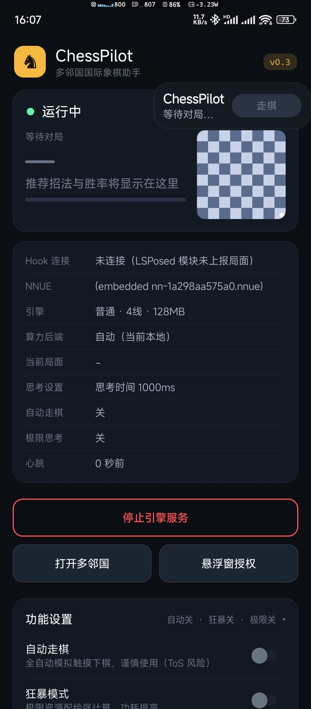
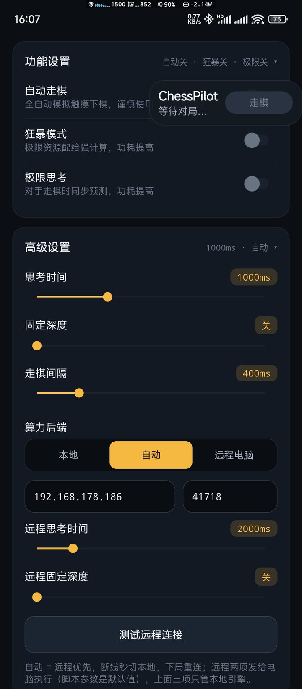
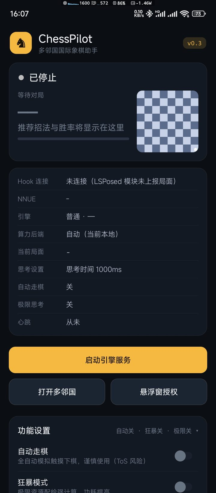

# ♟️ ChessPilot · 多邻国国际象棋助手

**开局就知道该走哪一步。**

实时胜率 · 最佳招法箭头 · 可选自动落子 · 手机本地或电脑算力

  

## 🚀 30 秒装上

> 先记住一件事：**这个模块只是「手」，引擎在伴侣 App 里。两个都要装，缺一个都不会动。**

1. 装本页的 APK → 在 **LSPosed** 里启用模块，作用域**只勾「多邻国」** → 重启手机
2. 装 [**伴侣 App**](https://github.com/a1175815821/ChessPilot/releases/latest) → 打开后点一次「启动引擎服务」，通知权限给一下
3. 进多邻国开一局 —— 棋盘上冒出金色箭头，就成功了

## ✨ 屏幕上会出现什么

| 画面元素 | 含义 |
|---|---|
| **金色箭头** | 引擎推荐你走的这一步 |
| **红色箭头** | 它预测对手接下来会走哪 |
| **胜率 / 评估分** | 当前局面谁更优，该稳还是该搏一眼就知道 |
| **悬浮窗胶囊** | 实时思考深度与最佳招法，可一键停 |

再往上一层还有：**自动走棋**（延迟可调，或悬浮窗按钮半自动确认）、**ponder 预判**（对手思考时提前算，命中就瞬时出招）、**狂暴模式**（线程拉满、大内存深算）、以及一个能看到每一步状态的**控制台**。

## 🖥️ 进阶：让电脑替你算（可选）

手机芯片算不过桌面 CPU。想要更强的棋力：

1. 电脑上双击 `pc/start-pc-engine.bat`（只需 Python 3.8+，Stockfish 自动下载）
2. 手机控制页 → 高级设置 → 算力后端切「远程」，填电脑的局域网 IP
3. 连接断了会**自动秒切回**手机本地引擎，一局都不耽误

细节见 [pc/README.md](https://github.com/a1175815821/ChessPilot/blob/master/pc/README.md)。

## 🔧 装完没反应？

| 现象 | 原因与处理 |
|---|---|
| 棋盘毫无变化 | LSPosed 作用域没勾多邻国，或改完没重启手机 |
| 有箭头但不更新 | 伴侣 App 的引擎服务没在跑（通知栏应有常驻通知），点一次「启动引擎服务」 |
| 多邻国更新后失效 | 应用混淆名变了导致 Hook 失效，需要等模块适配新版本 |
| 能不能只装模块 | 不能，引擎在伴侣 App 里 |

更细的排查对照表在 [使用手册](https://github.com/a1175815821/ChessPilot/blob/master/docs/USER_GUIDE.md)。

## 📱 兼容性

- 多邻国 **6.85.7**（arm64）—— 其他版本可能失效
- Android **8.1+**（minSdk 27，targetSdk 34）
- 需要 root + **LSPosed（Zygisk）**

## ⚠️ 免责声明

本模块会修改多邻国的运行行为，**违反其服务条款，存在封号风险**。仅供学习研究，请用小号折腾。

## ⭐ 源码与 Star

模块的全部源码、逆向笔记（Rive 画箭头、抗混淆三层回退、`remap.json` 再生流程）都在主仓库：

**https://github.com/a1175815821/ChessPilot**

如果它帮你多赢了几局，去点个 **Star** 就是最好的支持 —— 也方便你下次找到它。

GPL-3.0 开源；Stockfish 同为 GPL-3.0，分发二进制需附带源码获取方式。
